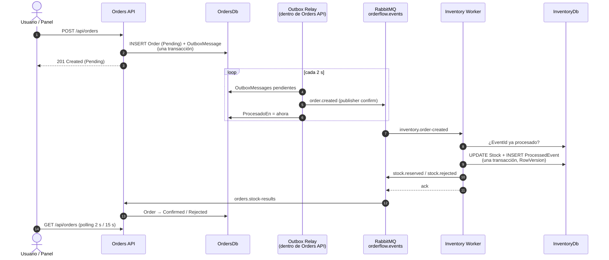

# 📦 OrderFlow — Prueba Técnica Q10

## 🧾 Descripción

Sistema distribuido para registrar pedidos y reservar inventario. Dos servicios .NET 10 se coordinan **por eventos** (RabbitMQ) y un panel web permite crear pedidos y ver cómo cambian de estado:

- **Orders API** (REST): valida el pedido, lo guarda como `Pending` y emite `OrderCreated` mediante un **Outbox transaccional**.
- **Inventory Worker**: consume `OrderCreated`, descuenta el stock de forma **idempotente** y responde `StockReserved` o `StockRejected`.
- **Orders API** consume la respuesta y deja el pedido en `Confirmed` o `Rejected`.
- **Frontend** (React + TanStack Query): formulario con validaciones y lista de pedidos que se refresca sola.



---

## 🚀 Características

- ➕ Crear pedidos con validación en el cliente **y** en el dominio (nombre obligatorio, SKU del catálogo, cantidad entre **1 y 100**); los errores del servidor se muestran debajo de cada campo.
- 🔄 Lista de pedidos que se refresca sola: **cada 2 s** mientras haya pedidos `Pending`, **cada 15 s** si no; paginada de 10 en 10 (TanStack Table).
- 📨 Mensajería asíncrona con **Outbox transaccional**, **publisher confirms**, colas **quorum** durables y **DLQ**.
- 🔁 **Idempotencia** en el consumidor: un mismo evento recibido dos veces descuenta el stock una sola vez.
- 🛡️ **Concurrencia optimista** (`RowVersion`) y `CHECK (Disponible >= 0)` en la base: nunca hay stock negativo.
- 🐳 Todo se levanta con `docker compose up`: frontend, 2 servicios, RabbitMQ, SQL Server y los datos de prueba.
- 🧪 **81 tests**: 51 de backend (xUnit) y 30 de frontend (Vitest).

---

## ⚙️ Tecnologías Usadas

| Backend | Frontend | Infraestructura |
|---|---|---|
| .NET 10 · C# · Minimal APIs | React 19 · TypeScript | Docker Compose |
| Entity Framework Core 10 (SQL Server) | Vite 7 | SQL Server 2022 |
| RabbitMQ.Client 7 (sin MassTransit) | TanStack Query 5 | RabbitMQ 4 (management) |
| OpenAPI + Scalar | TanStack Table 8 | nginx (unprivileged) |
| xUnit + SQLite en memoria | Vitest 4 + Testing Library | Imágenes .NET *chiseled* |

---

## 💡 Cómo Ejecutarlo

### Requisitos

- **Docker Desktop** (con al menos 4 GB de RAM para SQL Server).
- Para correr los tests o en modo desarrollo: **.NET SDK 10** y **Node 20.19+**.

### 🐳 Todo con Docker (un solo comando)

```bash
docker compose up --build
```

- **No hace falta crear el `.env`.** Si no existe, `docker-compose.yml` usa los mismos valores de ejemplo que [`.env.example`](.env.example). Para usar contraseñas propias: `cp .env.example .env` y cambiarlas (la de SQL Server debe tener mínimo 8 caracteres con mayúscula, minúscula, número y símbolo).
- **No hay migraciones (sin Code First).** Las bases, las tablas y los datos de prueba los crean los scripts de [`db/init/`](db/init), que el servicio `db-init` ejecuta con `sqlcmd` **antes** de que arranquen la API y el worker. Los scripts son idempotentes: se ejecutan en cada `up` sin duplicar nada.
- El primer build tarda unos minutos (descarga el SDK de .NET y Node). Para empezar de cero: `docker compose down -v`.

> ⚠️ SQL Server y RabbitMQ solo leen la contraseña cuando **crean su volumen**. Si cambias el `.env` después del primer `up`, haz `docker compose down -v`.

Orden de arranque: `sqlserver` (healthy) → `db-init` (crea esquema y seed, termina con 0) + `rabbitmq` (healthy) → `orders-api` e `inventory-worker` → `frontend`.

| Qué | URL | Credenciales |
|---|---|---|
| Panel (frontend) | http://localhost:3000 | — |
| API + documentación (Scalar) | http://localhost:8080/scalar | — |
| Health checks | http://localhost:8080/health/live · `/health/ready` | — |
| RabbitMQ Management | http://localhost:15672 | las del `.env` (sin `.env`: `guest_user` / `change_me`) |
| SQL Server | `localhost,1433` | `sa` / la del `.env` (sin `.env`: `YourStrong!Passw0rd`) |

### 🌱 Productos de prueba

El mismo seed en los dos servicios (`OrdersDb.Products` y `InventoryDb.Stock`):

| SKU | Producto | Stock | Para probar |
|---|---|---|---|
| `SKU-001` | Teclado mecánico | 100 | camino feliz → `Confirmed` |
| `SKU-002` | Mouse inalámbrico | 10 | pedir 11 → `Rejected` (`InsufficientStock`) |
| `SKU-003` | Monitor 27 pulgadas | 2 | dos pedidos lo agotan; el tercero → `Rejected` |
| `SKU-004` | Audífonos | 0 | siempre `Rejected` |

### 🔌 Endpoints (Orders API)

| Método | Ruta | Respuesta |
|---|---|---|
| `POST` | `/api/orders` | `201` + header `Location` · `400` ProblemDetails si los datos son inválidos |
| `GET` | `/api/orders?take=50` | pedidos más recientes primero (`take` entre 1 y 200, por defecto 50) |
| `GET` | `/api/orders/{id}` | `200` · `404` si no existe |
| `GET` | `/api/products` | catálogo para el formulario |

```bash
curl -i -X POST http://localhost:8080/api/orders \
  -H "Content-Type: application/json" \
  -d '{"nombreCliente":"Ana","sku":"SKU-001","cantidad":1}'

curl http://localhost:8080/api/orders/<id>     # Pending → Confirmed en ~2 s
```

Los errores siguen **ProblemDetails (RFC 9457)**, con los mensajes agrupados por campo y los códigos para que el frontend los pinte donde corresponde:

```json
{
  "status": 400,
  "title": "La solicitud tiene errores de validación",
  "errors": {
    "nombreCliente": ["El nombre del cliente es obligatorio."],
    "cantidad": ["La cantidad debe estar entre 1 y 100."],
    "sku": ["El SKU 'SKU-999' no existe en el catálogo."]
  },
  "codes": ["order.nombre_requerido", "order.cantidad_invalida", "order.sku_no_existe"]
}
```

### 🧑‍💻 Desarrollo local sin Docker (opcional)

```bash
docker compose up -d db-init rabbitmq        # solo base de datos (con su seed) y broker
```

Después, cada servicio desde el IDE o con `dotnet run`, definiendo las variables de entorno (la cadena apunta a `localhost,1433`):

| Servicio | Variables necesarias |
|---|---|
| Orders API (`backend/Orders.Infrastructure.In.WebApi`, perfil `http` → http://localhost:5109) | `ConnectionStrings__OrdersDb`, `RabbitMq__User`, `RabbitMq__Password` |
| Inventory Worker (`backend/Inventory.Infrastructure.In.Worker`) | `ConnectionStrings__InventoryDb`, `RabbitMq__User`, `RabbitMq__Password` |

Frontend: `cd frontend && npm install && npm run dev` → http://localhost:5173. El proxy de Vite reenvía `/api` a `http://localhost:8080` (la API en Docker); si la API corre con `dotnet run`, cambia el `target` en `vite.config.ts` a `5109`.

---

## 🧪 Tests

| Qué | Comando | Cantidad |
|---|---|---|
| Backend (xUnit) | `dotnet test backend/OrderFlow.slnx` | 51 (Orders 35 + Inventory 16) |
| Frontend (Vitest) | `cd frontend && npm test` | 30 |

**Ninguno necesita Docker** (el backend usa SQLite en memoria y fakes; el frontend, jsdom y `fetch` simulado). Qué cubren:

- **Dominio**: la máquina de estados completa (solo `Pending` admite `Confirm`/`Reject`, y un fallo no modifica el pedido), validaciones de `Order.Create` (incluido el rango 1–100) y la regla de stock.
- **Idempotencia de verdad** (`ReserveStockSqliteTests`): dos entregas del mismo mensaje, cada una con su `DbContext` → el stock se descuenta **una sola vez**.
- **Handlers con fakes**: orden "guardar → publicar", que si falla el guardado no se publica nada, y que un duplicado republica la misma respuesta.
- **Outbox**: el pedido y su evento se guardan juntos (o ninguno); el dispatcher corta el lote cuando falla una publicación.
- **Configuración crítica**: fail-fast sin cadena de conexión, `RowVersion`, PK no clustered + índice clustered en `CreadoEn`, longitudes de columnas, enums guardados como texto, índice filtrado del Outbox y validación de `RabbitMqOptions`.
- **Frontend**: validación del formulario, ritmo del polling, cliente HTTP (400/502/sin red), el formulario completo (errores en pantalla **sin** llamar a la API, errores del servidor bajo su campo) y la paginación de la tabla.

---

## 🛠️ Estructura del Proyecto

```
/db/init
├── 01-orders.sql        (OrdersDb: Products, Orders, OutboxMessages + seed)
└── 02-inventory.sql     (InventoryDb: Stock, ProcessedEvents + seed)

/backend                                  (OrderFlow.slnx)
├── OrderFlow.Contracts                   eventos de integración, exchange y routing keys (lo único compartido)
├── Orders.Domain                         Order y sus reglas (sin dependencias)
├── Orders.Application                    casos de uso (commands/queries), Outbox dispatcher y puertos
├── Orders.Infrastructure.Out.SqlServer   EF Core: repositorios, queries, Outbox, UnitOfWork
├── Orders.Infrastructure.Out.RabbitMq    conexión, topología y publicador con confirms
├── Orders.Infrastructure.In.WebApi       endpoints HTTP + relay del Outbox + consumidor de resultados
├── Inventory.Domain                      Stock y su regla de reserva
├── Inventory.Application                 ReserveStockHandler (idempotente) y puertos
├── Inventory.Infrastructure.Out.*        SqlServer (EF Core) y RabbitMq
├── Inventory.Infrastructure.In.Worker    Worker (Generic Host) + consumidor de OrderCreated
└── Orders.Tests / Inventory.Tests        xUnit

/frontend/src
├── api                     contratos (types.ts) y cliente HTTP con ApiError
├── features/orders
│   ├── components          OrderForm, OrdersTable, TablePagination, StatusBadge
│   ├── hooks               useProducts, useCreateOrder, useOrders (polling 2 s / 15 s)
│   └── validation.ts       mismas reglas que el dominio
└── test                    utilidades de Vitest
```

Regla de dependencias (hexagonal): `Domain` ← `Application` ← `Infrastructure.*`. El dominio no conoce a nadie; la aplicación define las interfaces que implementa la infraestructura.

---

## 🏛️ Arquitectura y Decisiones

- **Hexagonal (puertos y adaptadores).** El dominio y la aplicación no conocen EF Core ni RabbitMQ; dependen de interfaces (`IOrderRepository`, `IOutbox`, `IMessagePublisher`…). Por eso los handlers se testean con fakes. El relay del Outbox y los consumidores también son adaptadores **de entrada**: un timer o un mensaje impulsan la aplicación igual que un request HTTP.
- **CQRS ligero, sin MediatR.** Los commands (`CreateOrder`, `ConfirmOrder`, `RejectOrder`) pasan por el agregado; las queries proyectan directo a DTO con `AsNoTracking`. Mismo modelo y misma base: separar más no se justifica a esta escala. Los handlers son clases registradas en DI, sin librería de mediación.
- **`Result` en vez de excepciones** para los errores de negocio, traducidos a ProblemDetails en un solo sitio (`ErrorResults`). Las excepciones quedan para lo inesperado (500 sin detalles internos).
- **SQL Server, una base por servicio** (`OrdersDb`, `InventoryDb`). Ningún servicio lee la base del otro: solo se comunican por eventos. SQL Server porque soporta lo que el diseño necesita (`rowversion`, índices filtrados, `CHECK`) y corre en el compose.
- **Esquema con scripts SQL, sin migraciones.** El esquema queda versionado y visible en `db/init`, y el seed corre solo al levantar el sistema. A cambio, nada avisa automáticamente si el modelo de EF y el script dejan de coincidir: lo protegen los tests de configuración crítica.
- **RabbitMQ.Client a mano, sin MassTransit**, para que se vea el criterio: topología (exchange *topic*, colas *quorum*, DLX), publisher confirms, `mandatory`, la política de ack/nack, la idempotencia y el Outbox están escritos y a la vista. En un proyecto real MassTransit daría casi todo hecho; aquí ocultaría justo lo que se evalúa.
- **Outbox transaccional.** El pedido y su `OrderCreated` se guardan en el mismo `SaveChanges`: no existe pedido sin evento ni evento sin pedido. Un `BackgroundService` publica los pendientes (lotes de 20, más antiguos primero) con publisher confirms y los marca como procesados.
- **Idempotencia en el consumidor.** Inventory registra cada `EventId` en `ProcessedEvents` (PK, más índice único por `OrderId`) en la misma transacción que el descuento. Si el evento llega otra vez, no toca el stock y republica la respuesta guardada **con el mismo `ResultEventId`**. En Orders, un `StockReserved` duplicado se ignora porque la máquina de estados no permite confirmar dos veces.
- **Concurrencia optimista.** `Stock` y `Order` llevan `RowVersion`. Ante un conflicto, el consumidor reintenta hasta 3 veces con un `DbContext` limpio y, si sigue, devuelve el mensaje a la cola. El `CHECK (Disponible >= 0)` es la última defensa.
- **Configuración por variables de entorno.** Nada de cadenas ni secretos en el código o en `appsettings`: todo llega desde el `.env` vía compose (`ConnectionStrings__OrdersDb`, `RabbitMq__Password`…). Si falta algo obligatorio, el servicio **no arranca** (fail-fast con `ValidateOnStart`).
- **Frontend.** TanStack Query maneja caché, reintentos (no reintenta los 4xx) y el polling con intervalo dinámico; la validación del cliente replica la del dominio para dar respuesta inmediata, pero la verdad la tiene el servidor. nginx sirve el build y reenvía `/api` a la API por la red interna (sin CORS).
- **Docker.** Builds multi-stage, imágenes .NET *chiseled* (sin shell, sin root), nginx sin root y caché del `restore`/`npm ci` copiando primero los `.csproj`/`package-lock.json`.

---

## 🧯 Manejo de Fallos

Cada escenario se probó rompiendo el sistema a propósito; los resultados son reales.

### RabbitMQ caído cuando Orders intenta publicar

La API **no depende del broker para responder**: el pedido y su evento quedan en `OrdersDb` y devuelve `201 Pending`. El relay registra el fallo (`Intentos`, `UltimoError`), corta el lote y reintenta cada 2 s. Cuando el broker vuelve, publica y el flujo sigue.

```bash
docker compose stop rabbitmq
curl -i -X POST http://localhost:8080/api/orders -H "Content-Type: application/json" \
  -d '{"nombreCliente":"Ana","sku":"SKU-001","cantidad":1}'     # 201, Pending
docker compose start rabbitmq                                   # a los segundos → Confirmed
```

> Resultado: `Intentos` subió a 6 mientras el broker estaba caído; 7 s después de arrancarlo el pedido estaba `Confirmed`.

### Inventory no responde

`OrderCreated` espera en `inventory.order-created`, una cola **quorum y durable** con mensajes persistentes. Los pedidos quedan `Pending` hasta que vuelva el worker, que los procesa en orden. No se pierde nada.

```bash
docker compose stop inventory-worker    # crear pedidos: se quedan Pending
                                        # :15672 → Queues → inventory.order-created acumula mensajes
docker compose start inventory-worker   # la cola se vacía y los pedidos se resuelven
```

> Resultado: la cola llegó a 2 mensajes con 0 consumidores; al arrancar el worker, los 2 pedidos pasaron a `Confirmed`.

### El worker cae entre el descuento y la publicación

El descuento y el `ProcessedEvent` ya se guardaron, pero la respuesta no salió y el mensaje original **no tuvo ack**. RabbitMQ lo reentrega; el worker encuentra el `EventId` en `ProcessedEvents`, **no vuelve a descontar** y republica la respuesta guardada.

### Mensajes veneno

- JSON inválido, tipo desconocido o campos obligatorios vacíos → `nack(requeue: false)` → directo a la DLQ (`<cola>.dlq` vía `orderflow.dlx`).
- Errores transitorios → `nack(requeue: true)`; el `x-delivery-limit: 5` de la cola quorum lo manda a la DLQ al quinto intento, así un mensaje que siempre falla no bloquea la cola.
- Respuesta para un pedido inexistente → DLQ, para revisarla.

Para probarlo: :15672 → Exchanges → `orderflow.events` → *Publish message*, routing key `order.created`, payload `{"esto":"no es un pedido"}` → aparece en `inventory.order-created.dlq`.

---

## 🔁 Demostrar la Idempotencia, Paso a Paso

La idea: forzar que el Outbox publique **otra vez el mismo evento** y comprobar que el stock solo se descontó una vez. Los comandos son de bash (en Windows, Git Bash).

**1.** Atajo para consultar las bases (usa la contraseña que ya tiene el contenedor; `-I` es necesario para el `UPDATE` por el índice filtrado del Outbox):

```bash
sql() { docker compose exec -T sqlserver bash -c "/opt/mssql-tools18/bin/sqlcmd -S localhost -U sa -P \"\$MSSQL_SA_PASSWORD\" -C -I -W -Q \"$1\""; }
```

**2.** Stock inicial de `SKU-001`:

```bash
sql "SELECT Sku, Disponible FROM InventoryDb.dbo.Stock WHERE Sku = 'SKU-001'"
```

**3.** Crear un pedido de 5 unidades y esperar a que esté `Confirmed`:

```bash
curl -s -X POST http://localhost:8080/api/orders -H "Content-Type: application/json" \
  -d '{"nombreCliente":"Idempotencia","sku":"SKU-001","cantidad":5}'
```

**4.** Comprobar que el stock bajó 5 y que hay un `ProcessedEvent`:

```bash
sql "SELECT Sku, Disponible FROM InventoryDb.dbo.Stock WHERE Sku = 'SKU-001'"
sql "SELECT EventId, OrderId, Resultado FROM InventoryDb.dbo.ProcessedEvents"
```

**5.** Simular un duplicado: marcar el último mensaje del Outbox como no publicado. El relay lo vuelve a publicar en ≤ 2 s con **el mismo `EventId`**:

```bash
sql "UPDATE OrdersDb.dbo.OutboxMessages SET ProcesadoEn = NULL WHERE Id = (SELECT TOP 1 Id FROM OrdersDb.dbo.OutboxMessages ORDER BY OcurridoEn DESC)"
```

**6.** Ver los logs:

```bash
docker compose logs --tail 20 inventory-worker orders-api
```

- inventory-worker: `Pedido … : Reserved (duplicado, se republica)`
- orders-api: `StockReserved ignorado para el pedido …: No se puede confirmar un pedido en estado Confirmed.`

**7.** Repetir el paso 4: **el stock no cambió** y sigue habiendo **un solo** `ProcessedEvent` para ese pedido. El pedido sigue `Confirmed`.

También lo demuestra un test automático, sin Docker: `ReserveStockSqliteTests.ReserveStock_EventoDuplicado_DescuentaUnaSolaVez`.

---

## ⚖️ Trade-offs Asumidos

- **Seed duplicado.** Los mismos SKU están en `OrdersDb.Products` y en `InventoryDb.Stock` (`01-orders.sql` y `02-inventory.sql`), y hay que mantenerlos iguales a mano. En real, Inventory publicaría `ProductCreated` y Orders construiría su catálogo a partir de él.
- **Catálogos separados.** Orders valida que el SKU exista contra su propia copia, sin llamar a Inventory por HTTP (sin acoplamiento temporal). El stock de esa copia **no se actualiza**: el stock real solo lo conoce Inventory.
- **At-least-once.** El Outbox puede publicar dos veces (si cae entre publicar y marcar). Se acepta porque los consumidores son idempotentes; exactly-once entre base de datos y broker no existe sin un coste muy alto.
- **Sin timeout de `Pending`.** Si Inventory nunca responde (p. ej. el mensaje acabó en la DLQ), el pedido se queda `Pending`. Se ve en la DLQ, pero nada lo resuelve solo.
- **Polling en lugar de tiempo real.** Es lo más simple que funciona y no necesita infraestructura extra; el intervalo dinámico (2 s / 15 s) limita la carga.
- **Paginación en el cliente.** La tabla pagina los 50 pedidos más recientes que devuelve la API; para ver más haría falta paginar en el servidor.
- **Valores por defecto en el compose.** Permiten `docker compose up` sin pasos manuales, pero son credenciales de ejemplo solo para desarrollo local.

---

## 🔭 Qué Haría Distinto con Más Tiempo

- **SignalR** para empujar los cambios de estado al panel en lugar de hacer polling.
- **Outbox también en Inventory**, para que publicar la respuesta no dependa de que el mensaje original siga sin ack.
- **Timeout de `Pending` → `Rejected`**: un job que rechace los pedidos sin respuesta tras N minutos (motivo `Timeout`).
- **Inbox pattern en Orders**: registrar los `EventId` recibidos en lugar de apoyarse en que la transición inválida se ignore.
- **Paginación en el servidor** (cursor por `CreadoEn`) en `GET /api/orders`.
- **Read model de stock** en Orders, alimentado por eventos, para avisar antes de pedidos imposibles.
- **Testcontainers** (SQL Server y RabbitMQ reales) para probar la carrera de dos workers sobre el mismo SKU (`RowVersion`), que SQLite no puede simular.
- **Shared Kernel** para `Result`, `Error` y la base de `QueueConsumer`, hoy duplicados en cada servicio para no acoplarlos.
- **OpenTelemetry**: trazas que sigan el pedido de la API al worker y de vuelta (propagando `traceparent` en las cabeceras AMQP), más métricas de la cola y del Outbox.
- **Kubernetes**: Deployment + Service + ConfigMap por servicio, con liveness (`/health/live`) y readiness (`/health/ready`) —ya expuestos por la API—, límites de recursos, los scripts de `db/init` como `Job`, RabbitMQ con su Cluster Operator y KEDA para escalar el worker según la longitud de la cola.

---

## 🙋 Autor

### Yeimer Andres Jaramillo Fernandez
📧 Mail: Andresjara0897@hotmail.com <br/>
💼 GitHub: https://github.com/Jaferye97 <br/>
🔗 LinkedIn: https://www.linkedin.com/in/yeimerjarafer/ <br/>
